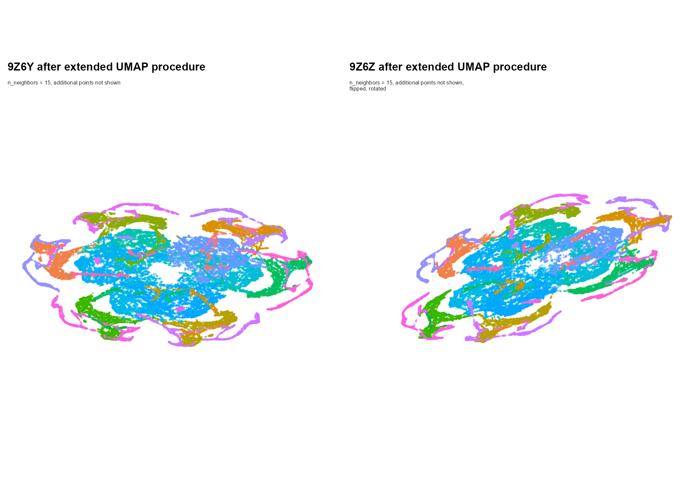
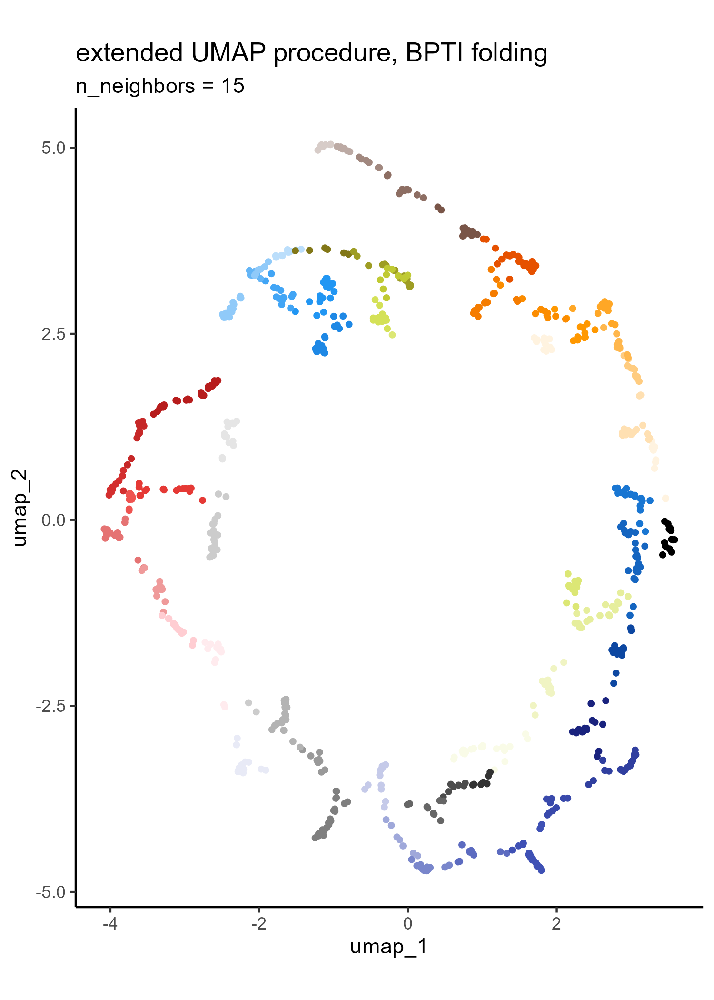
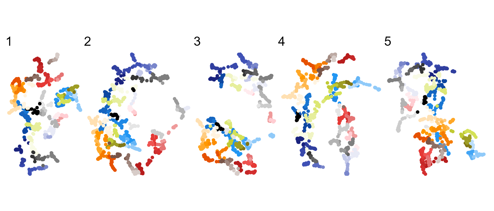
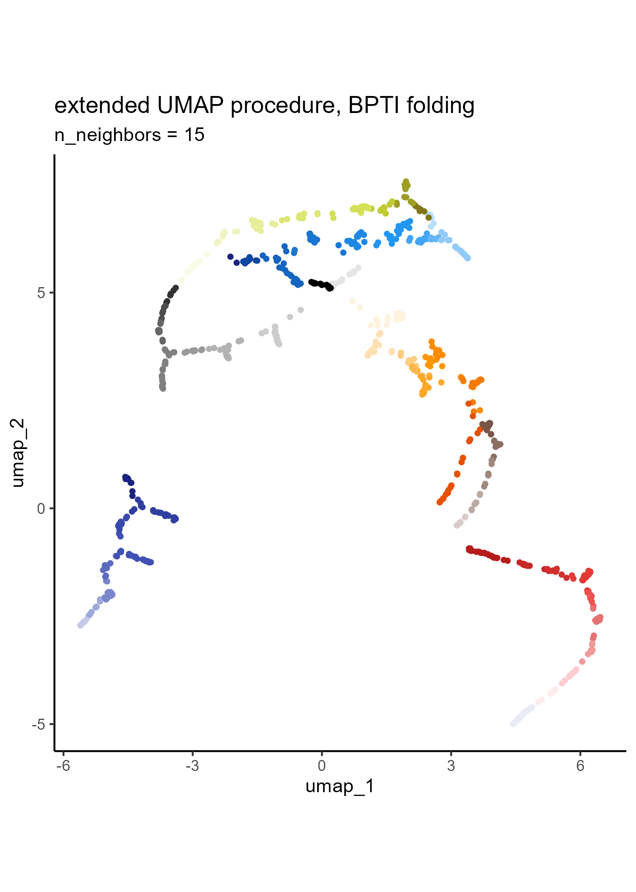
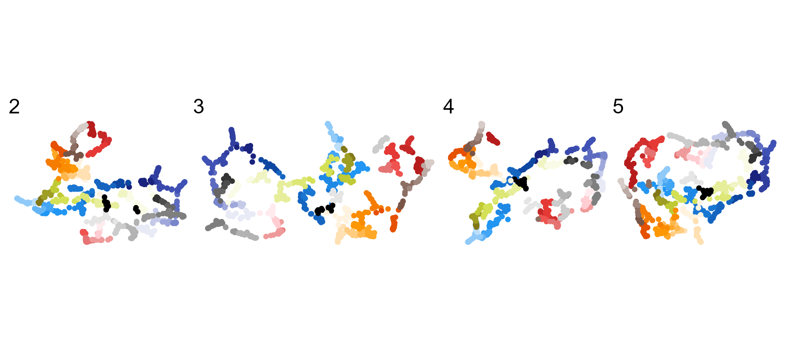

# extended_UMAP_additional-test

Some results obtained using UMAP for R (https://cran.r-project.org/web/packages/umap/) to get the planar depiction of various things extended with the additional data points (https://keldysh.ru/ngpm/2025/proc.pdf).

1. 3D structures of DRT proteins, https://www.rcsb.org/structure/9Z6Y (accessed on 14 of july 2026) and https://www.rcsb.org/structure/9Z6Z (accessed on 16 of july 2026) [DOI: https://doi.org/10.1126/science.aed1656].
  
    Observations:
   
         - Results of the extended UMAP seem to be more refined.

         - Resulting 2D diagrams seem to be mirrored and rotated one against the other. 

    Given the second observation, it is relatively easy to align the figures to make their comparative analysis more manageable:

        - Flip one of them LR

        - Rotate until the point clouds will generally match

    The results are given in **Figure 1**

   

   Imperfect alignment here is because of the global changes in structure: 9Z6Z has one longer and one shorter axes, also some overlaps of the subunits having distinct chainids is no more visible in comparison with 9Z6Y.

     **NB** Whether flipping the diagram is an appropriate transformation in this case is not discussed here from biological point of view.

2. Snapshots from molecular dynamics simulation of protein (BPTI) folding from highly cited paper [Shaw DE, Maragakis P, Lindorff-Larsen K, Piana S, Dror RO, Eastwood MP, Bank JA, Jumper JM, Salmon JK, Shan Y, Wriggers W. Atomic-level characterization of the structural dynamics of proteins. Science. 2010 Oct 15;330(6002):341-6. doi: 10.1126/science.1187409. PMID: 20947758.]

**Figure 2.** 5 snapshots of BPTI folding into one UMAP diagram. Points correpsonds to atoms colored according to their belonging to distinct residues.

**Figure 3.** 5 snapshots of BPTI folding into 5 UMAP diagrams. Points correpsonds to atoms colored according to their belonging to distinct residues.

As it can be seen from **Figure 3**, first snapshot is rather compact, maybe it is due to some technical reasons, thus, it is interesting to see the results without considering snapshot 1: **Figures 4** and **5**:

**Figure 4.** 4 snapshots of BPTI folding into one UMAP diagram. Points correpsonds to atoms colored according to their belonging to distinct residues.

**Figure 5.** 4 snapshots of BPTI folding into 5 UMAP diagrams. Points correpsonds to atoms colored according to their belonging to distinct residues.
